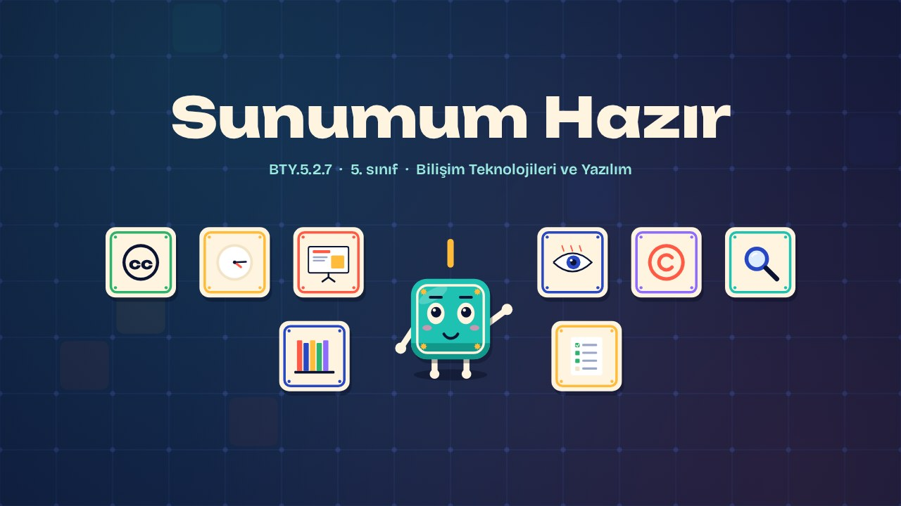
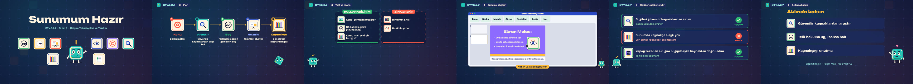

# Sunumum Hazır · My Deck Is Ready

**▶ Tarayıcıda izleyin / Watch in the browser:** https://hakanatas.github.io/sunumum-hazir/ 
**⬇ MP4 + altyazılar / MP4 + subtitles:** [Releases](https://github.com/hakanatas/sunumum-hazir/releases) 
**✎ Kullanılan istem / The prompt behind it:** [PROMPT.md](PROMPT.md) 
**🎞 Bütün filmler / All films:** [Bilişim Filmleri](https://hakanatas.github.io/bilisim-filmleri/?sinif=5)

> **TR —** 5. sınıf Bilişim Teknolojileri ve Yazılım dersinin "Dijital Ürün Tasarımı ve Geliştirme" temasındaki BTY.5.2.7 öğrenme çıktısı için hazırlanmış, tamamen JavaScript ile çizilen 2,1 dakikalık animasyon; ses efektleri ve hafif fon müziği de kodla üretilir. "Ekran Molası" konulu bir sunum dosyası hazırlanır. Önce süreç planlanır: konu, güvenilir kaynak, içerik seçimi, slaytlar ve kaynakça. İçerik seçerken telif hakkı ve lisanslar (Creative Commons, kamu malı) dikkate alınır. Sunum programında slayt eklenir, tema seçilir, başlık, maddeler ve görsel eklenir, geçiş ve konuşmacı notu kullanılır. Son olarak sunum; doğruluk, kaynakça, okunaklılık ve yapay zekâ içeriğinin kontrolü ölçütleriyle değerlendirilir. Altyazılar Türkçe, İngilizce ya da ikisi birlikte seçilebilir.

A 2.1-minute animation, with code-generated sound, for **5th-grade IT and Software** (Türkiye Yüzyılı Maarif Modeli). Karo builds a deck on screen breaks: plan the process, choose content with copyright and licences in mind, build slides with theme, bullets, images, transitions and speaker notes, and check it for accuracy, references, readability and verified AI content. The guide is **Karo**, a living glazed tile who never speaks: he tells the story with his face, his arms and the blinking cursor above his head.

## Öğrenme çıktısı · Learning outcome

MEB, Türkiye Yüzyılı Maarif Modeli, Bilişim Teknolojileri ve Yazılım Dersi Öğretim Programı, 5. sınıf, 2. tema "Dijital Ürün Tasarımı ve Geliştirme":

**BTY.5.2.7. Sunum dosyası geliştirebilme**
- a) Sunum dosyası oluşturur.
- b) Oluşturulan sunum dosyasını belirlenen ölçütler açısından değerlendirir.

## Sahneler · Scenes

| # | Zaman | Sahne | Ne oluyor | Çıktı |
|---|---|---|---|---|
| 1 | 0:00–0:15 | Giriş |  |  |
| 2 | 0:15–0:37 | Plan | Konu, güvenilir kaynak, içerik seçimi, slaytlar ve kaynakça. | a |
| 3 | 0:37–0:59 | Telif ve lisans | Hangi içerik serbestçe kullanılabilir, hangisi izin gerektirir? | a |
| 4 | 0:59–1:27 | Sunumu oluştur | Tema, başlık, maddeler, görsel, geçiş ve konuşmacı notu. | a |
| 5 | 1:27–1:49 | Ölçütlerle değerlendir | Sunum doğruluk, kaynakça, okunaklılık ve yapay zekâ içeriğinin kontrolü açısından değerlendirilir. | b |
| 6 | 1:49–2:05 | Aklında kalsın |  |  |

## Çalıştırma · Running it

- **Önizleme:** `index.html` dosyasına çift tıklayın (çevrim dışı da çalışır). Klavye: boşluk oynat/duraklat, ← → 3 sn, Home başa. Adrese `?altyazi=en`, `?bicim=vertical` ya da `?ses=0` eklenebilir.
- **MP4:** bir kez `npm install`, sonra `npm run export -- --format=both --captions=tr` (720p yatay ve dikey, sesli). Google Chrome yüklüyse Playwright onu kullanır (`channel: 'chrome'`); ffmpeg gerekir.
- **Altyazı ve seslendirme notları:** `npm run srt` → `out/sunumum-hazir_tr.srt`, `_en.srt`, `_tr-en.srt`, `_seslendirme-notlari.txt`.
- **Sürüm dosyaları:** `npm run release` → `release/` klasöründe v1.0'ın 6 dosyası.
- **Yazı kontrolü:** `npm run check` yatay ve dikey düzende, üç altyazı seçeneğiyle üst üste binen, kenardan taşan ya da 720p'de 17 pikselden küçük kalan yazı arar.
- **Düzenleme:** senaryo (sahneler, altyazılar, seslendirme notları) `scenes/film.js` içindedir; değiştirince `npm run build` süreleri, `captions.js` ve `film.config.js` dosyalarını yeniden üretir. Sahne şablonları `src/kit/`, Karo `src/draw/karo.js`, ses `src/audio/synth.js`.

Her kare `renderFrame(t)` ile zamanın saf fonksiyonu olarak çizilir; rastgelelik tohumludur, MP4 ekran kaydı değil kare kare üretimdir. Ses de dosyadan çalınmaz: aynı olay listesinden hesaplanır. Yazı tipleri: Unbounded ve Bricolage Grotesque (SIL OFL 1.1), dosyaya gömülü.

## Lisans · License

**TR —** Bu film ve kodu [Creative Commons Atıf-GayriTicari 4.0 Uluslararası (CC BY-NC 4.0)](https://creativecommons.org/licenses/by-nc/4.0/deed.tr) lisansıyla paylaşılır. Ticari olmayan her amaçla (derste, okulda, eğitim materyalinde) kopyalayabilir, paylaşabilir ve değiştirebilirsiniz; ancak **kaynak göstermek zorunludur**: eser sahibinin adı ve bu deponun bağlantısı belirtilmeden kullanılamaz. Ticari kullanım (satış, ücretli ürün ya da yayın) için izin alınmalıdır.

**EN —** This film and its code are licensed under [Creative Commons Attribution-NonCommercial 4.0 International (CC BY-NC 4.0)](https://creativecommons.org/licenses/by-nc/4.0/). You may copy, share and adapt them for non-commercial purposes, but **attribution is required**: they may not be used without crediting the author and linking to this repository. Commercial use requires permission.

Atıf örneği / Required credit: *“Sunumum Hazır”, Hakan Ataş, Bilişim Filmleri — https://github.com/hakanatas/sunumum-hazir — CC BY-NC 4.0*
